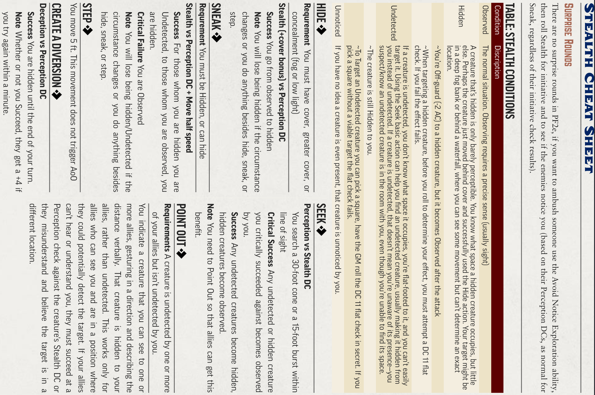

# HOUSE RULES AND REMINDERS

*Tuesday, October 14, 2025 8:15 PM*

AMBUSH RULES:

- If you successfully sneak within range of an attack, you may choose to attack from an undetected state. If you do, you automatically go first in the next combat.

Prepare (Action)

│

▼

Ally makes skill check / attack ──► You use Aid (Reaction)

│

▼

You roll a check

│

┌────────────┼──────────────────────────┐

▼            ▼                          ▼

Crit Success  Success                Crit Failure

+2/+3/+4      +1                         –1
